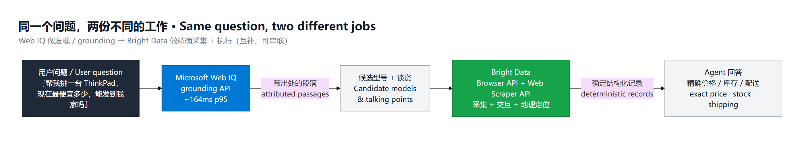
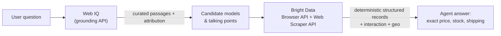

# Demo 4 · Microsoft Web IQ vs Bright Data — complementary layers

**One question, two jobs.** This demo answers a single shopping-agent question with two
different web primitives, side by side, to show they are *not* competitors — they are
layers you chain.

- **Microsoft Web IQ** — a grounding API. You hand it a natural-language question; it
  returns fresh, curated, token-optimized passages from across the web, with attribution.
  Fast (p95 ~164 ms). It answers *"what does the web say?"*
- **Bright Data** — a collection and action layer. You hand it target sites, URLs, and
  interactions; it returns deterministic structured records from the exact pages, plus
  geo-targeting and the ability to drive a real browser. It answers *"what is this specific
  page right now, and can my agent act on it?"*

## The scenario

Sarah runs a marketplace of shopping agents. A user asks:

> "Help me pick a Lenovo ThinkPad — and tell me the cheapest price right now and whether
> it can ship to my home."

That one question splits cleanly into two jobs:

| Sub-question | Best primitive | Why |
| --- | --- | --- |
| "Which ThinkPad should I consider?" | **Web IQ** | Grounded, conversational, token-efficient discovery across reviews and news. |
| "What is the cheapest price *right now*, and can it ship here?" | **Bright Data** | Deterministic price/ASIN/stock from the live PDP, geo-targeted, with page interaction. |

## Mental model





Web IQ grounds the agent; Bright Data collects the exact data and performs the action.
In a real agent the two are chained: **discover/ground with Web IQ → collect + act with
Bright Data.**

## Side-by-side comparison

| | **Microsoft Web IQ** | **Bright Data** |
| --- | --- | --- |
| Primitive | Natural-language grounding/retrieval | Site collection + browser action |
| You specify | A question | Target sites / URLs / interactions |
| Output | Curated passages + attribution | Deterministic structured records |
| Freshness / price | "What the web says" | Exact price / ASIN / stock right now |
| Site targeting | No (web-wide) | Yes (any specific page) |
| Interaction | None | Click, search, login, checkout |
| Geo / anti-bot | Handled, opaque | Geo-targeted, 5-layer unblocking |
| Structured extraction | Passages (text) | Schema'd JSON (managed parser) |
| Latency | ~164 ms p95 | Seconds–minutes (real collection) |
| Best for | Discovery / RAG grounding | Precise data + agent actions |
| Deployment | REST or MCP (HTTP) | API, Browser API, MCP, proxies |

## What the script does

[compare.py](compare.py) runs both layers on the same question:

- **Left — real Web IQ call**: `POST https://api.microsoft.ai/v3/search/web` with header
  `x-apikey: <KEY>`, prints the grounded passages and the round-trip latency.
- **Right — Bright Data**: by default it replays the most recent structured collection from
  [../../task2_amazon_flow/output](../../task2_amazon_flow/output) (instant, still real data).
  Pass `--bd-live` to run the real Browser API → Web Scraper API flow now.
- Then it prints the **"same question → two jobs"** summary table.

## Setup

```powershell
cd demos/demo4_webiq_vs_brightdata
Copy-Item .env.example .env        # then fill in WEBIQ_API_KEY
# (Bright Data creds only needed for --bd-live)
```

Dependencies are already in the workspace venv (`requests`, `python-dotenv`, `playwright`).

## Run

```powershell
# Web IQ live + Bright Data replayed from cached collection (fast, recommended for the live demo)
python compare.py --query "best Lenovo ThinkPad for travel under $1500" --keyword "lenovo thinkpad"

# Both layers fully live (slower — Bright Data collects in real time)
python compare.py --query "best Lenovo ThinkPad for travel under $1500" --keyword "lenovo thinkpad" --bd-live
```

## MCP option

Web IQ also ships an HTTP MCP server, so an agent can call it as a tool instead of via REST.
The config is in [webiq_mcp.json](webiq_mcp.json):

```json
{
  "mcpServers": {
    "WebIQ-MCP": {
      "url": "https://api.microsoft.ai/v3/mcp",
      "type": "http",
      "headers": { "x-apikey": "<your-api-key>" }
    }
  }
}
```

Pair it with the Bright Data MCP server (see [../demo3_mcp_agent](../demo3_mcp_agent)) and a
single agent can **ground with Web IQ and collect/act with Bright Data in one tool loop.**

## Talk track (interview)

> "I deliberately did *not* frame these as competitors. Web IQ is a grounding API — you give
> it a question, it gives you fast, token-efficient passages with attribution. That's perfect
> for the discovery half of a shopping agent. But it can't tell you the exact price on this
> ASIN right now, it can't target a specific site, and it can't click 'add to cart' or check
> shipping to a postcode. That's Bright Data's job — deterministic structured collection plus
> real browser interaction and geo-targeting. In a real agent you chain them: Web IQ grounds
> the conversation, Bright Data collects the precise data and performs the action. Same
> question, two different jobs."

## Honesty note

Web IQ is currently limited-access for select Azure customers. Product facts here
(grounding API, ~164 ms p95, token-optimized passages with attribution, REST + HTTP MCP) come
from the official site, <https://webiq.microsoft.ai/>. The request-body field names (`query`,
`count`) are the sensible defaults the script uses; adjust them in `compare.py` if your portal
documents different names.
